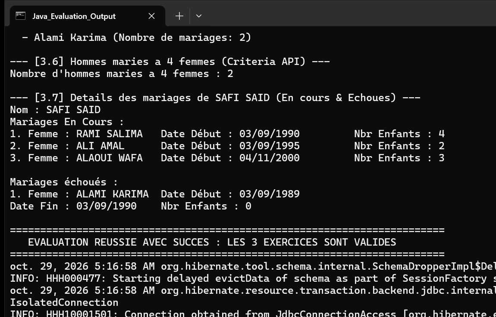

# Évaluation Finale : Hibernate & JPA - 3 Exercices de Synthèse

Ce projet regroupe l'implémentation complète des 3 exercices d'évaluation pratique en Java 17 avec JPA 2.2 et Hibernate 5.6.

## Structure et Description des Exercices

### Exercice 1 — Application de Gestion de Stock
- **Packages :** `ma.projet.classes.stock`, `ma.projet.service.stock`
- **Entités :** `Categorie`, `Produit`, `Commande`, `LigneCommandeProduit` (avec clé primaire composée `@EmbeddedId LigneCommandeProduitPK`).
- **Fonctionnalités :**
  - Affichage des produits par catégorie.
  - Recherche des produits commandés dans un intervalle de dates.
  - Affichage tabulaire formaté des détails d'une commande (Référence, Prix unitaire, Quantité).
  - Requête nommée `@NamedQuery` pour filtrer les produits dont le prix est strictement supérieur à 100 DH.

### Exercice 2 — Application de Gestion de Projets
- **Packages :** `ma.projet.classes.projet`, `ma.projet.service.projet`
- **Entités :** `Employe`, `Projet`, `Tache`, `EmployeTache` (association avec dates réelles de début et fin).
- **Fonctionnalités :**
  - Consultation des projets dirigés par un employé en tant que chef de projet.
  - Consultation des tâches assignées à un employé.
  - Affichage formaté des tâches planifiées et réalisées pour un projet donné.
  - Requête nommée `@NamedQuery` sélectionnant les tâches avec un coût supérieur à 1000 DH.
  - Suivi des tâches exécutées dans un intervalle temporel donné.

### Exercice 3 — Application de Gestion de l'État Civil
- **Packages :** `ma.projet.classes.etatcivil`, `ma.projet.service.etatcivil`
- **Entités :** `Personne` (classe mère abstraite avec `@Inheritance(strategy = InheritanceType.JOINED)`), `Homme`, `Femme`, `Mariage`.
- **Validation des 8 points du cahier des charges :**
  1. Création et persistance de 10 femmes et 5 hommes.
  2. Affichage complet de la liste des femmes enregistrées.
  3. Recherche et affichage de la femme la plus âgée.
  4. Liste des épouses d'un homme donné entre deux dates.
  5. Calcul du nombre d'enfants d'une femme via requête native nommée `@NamedNativeQuery`.
  6. Détection des femmes mariées au moins deux fois via `@NamedQuery` avec agrégation `COUNT(m) >= 2`.
  7. Dénombrement des hommes mariés à 4 femmes via Criteria API.
  8. Affichage détaillé et distinct des mariages en cours et des mariages échoués/terminés pour un homme.

## Exécution et Tests

### Commandes Maven
Lancement de l'ensemble des tests unitaires JUnit :
```bash
mvn clean test
```

Lancement de l'application principale de démonstration :
```bash
mvn clean compile exec:java -Dexec.mainClass="ma.projet.test.App"
```

## Résultat d'Exécution

La capture ci-dessous montre la sortie console complète de l'application `ma.projet.test.App`.



### Description de la Capture
- L'en-tête de la console affiche le lancement des trois modules d'évaluation sur l'unité de persistance `evaluationPU`.
- Section 1 : Validation de la gestion de stock avec affichage de la commande 4 au format tabulaire demandé et exécution de la requête nommée sur les prix.
- Section 2 : Validation de la gestion de projets avec suivi des tâches planifiées, tableau d'avancement réel et filtrage des coûts > 1000 DH.
- Section 3 : Validation complète de l'état civil illustrant les 8 points obligatoires (liste des femmes, femme la plus âgée, épouses par période, comptage d'enfants en requête native, détection de polygamie via Criteria API, et distinction mariages en cours / échoués).
- Clôture normale et libération des ressources.
